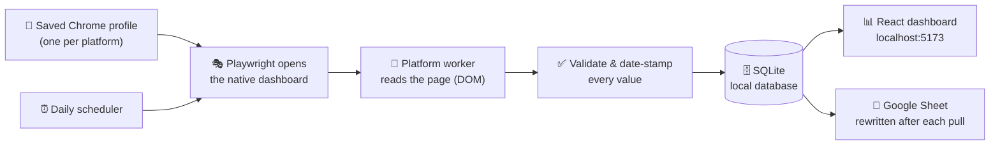

<div align="center">

# 📊 Layan Je Analytics

**Sign in once. Get your YouTube, TikTok, Instagram and Facebook numbers every day, automatically.**

A local-first social media analytics engine by **Bruz Digital**.
It reads each platform's own dashboard like a person would, stores every number with the date range it covers,
and keeps a Google Sheet and a live dashboard up to date — no social media API keys needed.

<br>


</div>

---

## ✨ Why Layan Je

| | |
|---|---|
| 🔐 **Sign in once** | Each platform gets its own saved Chrome profile. Log in one time; every later pull reuses it — no repeated logins, no incognito-style sessions that platforms revoke. |
| 🎯 **Same answer every time** | Numbers are read by fixed code from the page itself (DOM), not guessed by a model. The same dashboard always gives the same result. |
| 🔑 **No social media API keys** | Works on the dashboards you already use: YouTube Studio, TikTok Studio, Meta Business Suite, Instagram. Nothing to apply for, nothing to approve. |
| 📅 **Honest dates** | Every value is stored with the exact period the dashboard shows (e.g. *Last 28 days: 29 Oct – 25 Nov*), not the period that was asked for. |
| 📗 **Google Sheet always current** | After every pull the Sheet is rewritten from the database — never appended — so re-pulls can't create duplicate rows. |
| ⏰ **Runs itself** | Daily schedules pull every platform and update the Sheet. A missed run (computer off) runs as soon as the app is back. |
| 🧾 **Every run explained** | Each pull is logged with its status and, when it fails, the reason. Crashed runs are closed as *interrupted*, never left "running". |
| 💻 **Your data stays on your machine** | Backend binds to `127.0.0.1`. Logins, cookies and the database never leave your computer. |

---

## 📱 What it reads

| Platform | Source | Account numbers | Per post / video |
|---|---|---|---|
| ▶️ **YouTube** | YouTube Studio → Analytics | Views, watch time (hours), subscribers gained / lost / net, total subscribers | Content-tab video table *(early)* |
| 🎵 **TikTok** | TikTok Studio → Analytics | Video views, profile views, likes, comments, shares, est. rewards, total & net followers | *coming next* |
| 📸 **Instagram** | Insights *(Professional accounts)*<br>Profile page *(any account)* | Reach, engagement, followers, profile visits — or, without Insights: followers, following, posts | Likes, comments, reel plays, date, caption |
| 👍 **Facebook** | Meta Business Suite *(Pages / professional mode)*<br>Profile timeline *(any profile)* | Views, interactions, net follows, visits and more — or, without insights: friends / followers | Reactions, comments, shares, caption |

> **No insights? Still works.** Instagram accounts that aren't Professional, and Facebook profiles without
> professional mode, fall back to the numbers their profile shows — so you can test with any account today
> and get full insights as soon as the account is upgraded, with no code change.

Pick which Facebook Page to pull with `FACEBOOK_TARGET_PAGES` (first match wins). Pages not on the list are never pulled.

---

## 🧭 How it works



**Principle: deterministic code first, AI second.** The extraction is plain code. An AI provider
(DeepSeek or OpenAI — one at a time) is optional and is never sent passwords, cookies or tokens.

---

## 🚀 Quick start

### 1. Requirements

- **Windows** with PowerShell (other OSes work with the equivalent commands)
- **Python 3.11+** and **Node.js 22+**
- **Google Chrome** installed (sign-ins use real Chrome so Google accepts them)
- *Optional:* a DeepSeek or OpenAI API key, and a Google service account for Sheets

### 2. Install

```powershell
git clone https://github.com/ahmd-byte/layanjer-analytic.git
cd layanjer-analytic

# Backend
cd backend
python -m venv .venv
.venv\Scripts\Activate.ps1
pip install -e ".[dev]"
playwright install chromium

# Frontend
cd ..\frontend
npm install
cd ..
```

### 3. Configure

```powershell
Copy-Item .env.example .env
```

Then fill in `.env` (never commit it — it's git-ignored):

| Setting | What it's for |
|---|---|
| `GOOGLE_SHEETS_CREDENTIALS_PATH` | Path to your Google service-account JSON (keep it in `credentials/`, which is git-ignored) |
| `GOOGLE_SHEETS_SPREADSHEET_ID` | The ID from your Sheet's URL. **Share the Sheet with the service account's email as _Editor_.** |
| `FACEBOOK_TARGET_PAGES` | Facebook Page / profile names to pull, comma-separated, first match wins |
| `AI_PROVIDER`, `AI_API_KEY` | *Optional.* `deepseek` or `openai` |
| `APP_TIMEZONE` | Defaults to `Asia/Kuala_Lumpur`; used for dates and Sheet timestamps |
| `BROWSER_HEADLESS` | `false` (default) shows the browser window — needed for sign-in |

### 4. Start

```powershell
.\start.ps1
```

| | |
|---|---|
| 📊 Dashboard | http://localhost:5173 |
| ⚙️ API docs | http://127.0.0.1:8000/docs |

> Keep the backend running for daily schedules to fire.

### 5. Connect each platform (once)

Open the platform's page in the dashboard → **Connect Account**. A Chrome window opens on the
platform's own sign-in page: log in yourself (2-step checks and puzzles included). The window closes
when you're in, and the sign-in is saved for every future pull.

### 6. Pull

Click **Pull Analytics**. You'll see *"Extracted N metrics (completed) · Google Sheet updated"* —
the numbers are in the dashboard and the Sheet.

### 7. Go automatic

**Operations → Schedules:** add a schedule per platform with an interval of `1440` minutes (daily).
Each run pulls the last 7 days plus posts, saves them, and updates the Sheet.

---

## 📗 The Google Sheet

Rewritten from the database after every successful pull, so it always matches the dashboard exactly.

| Tab | One row per | Columns |
|---|---|---|
| **Account Metrics** | metric × period | Platform · Account · Metric · Value · Date Start · Date End · Source · Method · Extracted At |
| **Content Metrics** | post × metric × day | Platform · Account · Content ID · Type · Title · Metric · Value · Dates · Published · URL · Extracted At |
| **Summary** | metric (latest value) | Platform · Account · Metric · Latest Value · Period · Last Updated |

Times are shown in your local time zone (`APP_TIMEZONE`). If Sheets is unreachable, the pull is still
saved and the dashboard shows a warning.

---

## 🖥️ Dashboard

| Page | What you get |
|---|---|
| **Overview** | Accounts, metric counts, metrics by platform, recent extractions, system status |
| **YouTube · TikTok · Instagram · Facebook** | Headline cards with each value's period, trend chart, posts table, every extracted metric |
| **Operations** | Extraction runs with status and failure reasons, schedules, health |
| **Settings** | AI provider, Google Sheets connection test, configuration status |

---

## 🧰 Command line

```powershell
cd backend
.venv\Scripts\Activate.ps1
```

| Command | Does |
|---|---|
| `layan setup` | Create / upgrade the local database |
| `layan run` | Start the API server on `127.0.0.1:8000` |
| `layan health` | Check the database, AI provider and Google Sheets configuration |
| `layan backup` | Copy the database to the backup folder |

Pulling is done from the dashboard or by schedules.

---

## 🗂️ Project structure

```
layanjer-analytic/
├── backend/
│   ├── src/layan_engine/
│   │   ├── api/            FastAPI app and routes (per platform, analytics, scheduler, sheets)
│   │   ├── browser/        Persistent Chrome profiles, challenge detection
│   │   ├── platforms/      youtube · tiktok · instagram · facebook workers
│   │   ├── storage/        SQLite models, upserts, run bookkeeping
│   │   ├── sheets/         Google Sheets client and full-rewrite sync
│   │   ├── scheduler/      Background loop for daily pulls
│   │   ├── ai/             Optional DeepSeek / OpenAI provider and budget
│   │   └── hardening/      Validation, rate limiting, error handling
│   └── tests/              pytest suite (runs against a throwaway database)
├── frontend/               React 19 + Vite + TypeScript + Tailwind + Recharts
├── docs/                   Technology decisions
├── start.ps1               One-command start for backend + frontend
└── .env.example            Configuration template
```

Git-ignored and local only: `.env`, `credentials/`, `browser_profiles/`, `local_data/`.

---

## 🧪 Testing

```powershell
cd backend
python -m pytest -q
```

The suite never touches your real data: it uses a temporary database and browser-profile folder,
and blanks the AI and Sheets settings so no live service is called.

---

## 🛡️ Security & privacy

- 🏠 Backend listens on `127.0.0.1` only.
- 🔑 Secrets live in `.env`; the service-account key in `credentials/`. Both are git-ignored.
- 🍪 Browser profiles (logins, cookies) stay in `browser_profiles/`, git-ignored.
- 🤖 AI providers never receive passwords, cookies or tokens; page content is treated as untrusted.
- 👤 You sign in yourself, in the platform's own window. The app never types or stores passwords.

---

## 🩺 Troubleshooting

| You see | Do this |
|---|---|
| *Google Sheet not updated: Permission denied* | Share the Sheet with the service account's email as **Editor** |
| *Not signed in* / sign-in page during a pull | Click **Re-authenticate** on that platform and log in once |
| Instagram shows only followers / following / posts | The account isn't Professional. Switch it in the Instagram app for full Insights |
| Facebook shows only friends / followers | The profile has no professional mode. Turn it on, or add a Page to `FACEBOOK_TARGET_PAGES` |
| *None of the Facebook targets were found* | The error lists the Pages your login manages — fix `FACEBOOK_TARGET_PAGES` |
| TikTok values are 0 | TikTok shows `--` for periods with no activity; these are stored as 0 |
| A run shows *Interrupted* | The app stopped mid-run. The next scheduled or manual pull picks it up |

---

## 🗺️ Roadmap

- [x] Persistent sign-ins for all four platforms
- [x] YouTube Studio, TikTok Studio, Meta Business Suite and Instagram extraction
- [x] Profile-number fallback for accounts without insights
- [x] Automatic Google Sheet sync after every pull
- [x] Daily schedules with failure tracking
- [ ] Full per-video numbers for YouTube and TikTok
- [ ] Shows & episodes: group a live show and its clips across platforms
- [ ] AI-assisted recovery when a dashboard layout changes
- [ ] Audience breakdowns (age, gender, location, traffic sources)
- [ ] Command-line `pull`, `backfill` and `sync`

---

## 👩‍💻 Development

All work happens on the **`ahmad-branch`** branch. Run the tests before every push, and never commit
secrets, cookies or real client data.

```powershell
git checkout ahmad-branch
git pull origin ahmad-branch
```

Project rules and architecture notes: [`CLAUDE.md`](CLAUDE.md) · progress: [`DEVELOPMENT_STATUS.md`](DEVELOPMENT_STATUS.md) ·
decisions: [`docs/TECHNOLOGY_DECISIONS.md`](docs/TECHNOLOGY_DECISIONS.md) · licences: [`THIRD_PARTY.md`](THIRD_PARTY.md)

---

<div align="center">

**Proprietary — © Bruz Digital. All rights reserved.**

</div>
